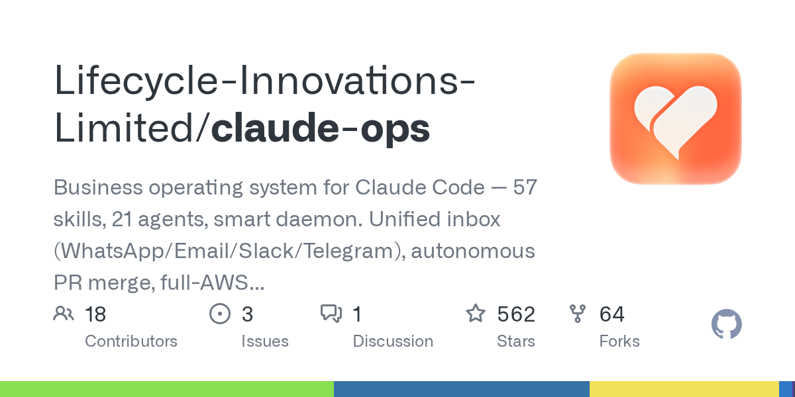

# Best Claude Code Mods

[English](README.md) · [简体中文](README.zh-CN.md) · [繁體中文](README.zh-TW.md) · [日本語](README.ja.md) · [한국어](README.ko.md) · **Español** · [Français](README.fr.md) · [Deutsch](README.de.md) · [Português (Brasil)](README.pt-BR.md) · [Русский](README.ru.md)

**Elegidos a mano, validados y fijados. Una sola adición, 41 mods.**

Los mods son plugins de Claude Code hechos con hooks de funciones: observan, cambian o responden a lo que hace Claude Code, y dibujan su propia interfaz. Este marketplace reúne los mejores mods de la comunidad. Cada uno se ha comprobado con `claude plugin validate` y está fijado al commit comprobado, así que los cambios posteriores de su autor nunca te llegan sin revisar.

Requiere Claude Code 2.1.287 o posterior.

## Instalación

En una sesión de Claude Code en el terminal:

```
/plugin marketplace add claude-code-mods/best-claude-code-mods
/plugin install <mod>@best-claude-code-mods
```

Por ejemplo `/plugin install terminal-browser@best-claude-code-mods`. Ejecuta `/plugin marketplace update best-claude-code-mods` para recibir mods nuevos y actualizaciones.

## Catálogo

El campo **Acceso** de cada tarjeta indica lo que, según el validador, puede hacer el código del mod además de dibujar interfaz. Lee el código de un mod antes de instalarlo: la validación lo lee sin ejecutarlo y no es una auditoría de seguridad.

### Paneles y uso

[](https://github.com/alexgreensh/token-optimizer/tree/e3f1a2dcad8d8999096b8a881c4d98cdba4ef1a5/desktop/token-optimizer-desktop)

#### [`token-optimizer`](https://github.com/alexgreensh/token-optimizer/tree/e3f1a2dcad8d8999096b8a881c4d98cdba4ef1a5/desktop/token-optimizer-desktop)

*de alexgreensh* · A token-optimizer status bar that shows where tokens go and how to spend less.

**Acceso:** ejecuta comandos, llama a modelos, archivos

`/plugin install token-optimizer@best-claude-code-mods`

[](https://github.com/hex/claude-council/tree/f2f7f42122b288599cef8cea97dcc490acea98a5)

#### [`claude-council`](https://github.com/hex/claude-council/tree/f2f7f42122b288599cef8cea97dcc490acea98a5)

*de hex* · Consult several AI agents at once for diverse perspectives, with a streaming pane and an optional heads-up side check.

**Acceso:** ejecuta comandos, llama a modelos, archivos

`/plugin install claude-council@best-claude-code-mods`

[](https://github.com/chipfighter/context-attachment-manager/tree/d68a721b7432059c9056d546ff2a26b11b3c0e0c)

#### [`codex-attachment-manager`](https://github.com/chipfighter/context-attachment-manager/tree/d68a721b7432059c9056d546ff2a26b11b3c0e0c)

*de chipfighter* · Sends earlier images as short placeholders and fetches originals back by ID, so long image sessions keep the prompt cache.

**Acceso:** red, MCP

`/plugin install codex-attachment-manager@best-claude-code-mods`

[](https://github.com/karanb192/cache-tax/tree/535ff33225e666e605e731d78f5ac5efe243c7c3)

#### [`cache-tax`](https://github.com/karanb192/cache-tax/tree/535ff33225e666e605e731d78f5ac5efe243c7c3)

*de karanb192* · Keeps the one-hour prompt cache warm during breaks, asking before a cold send and showing the rewrite cost.

**Acceso:** llama a modelos

`/plugin install cache-tax@best-claude-code-mods`

[](https://github.com/Atoll92/agent-standup/tree/846d5324f7c00f06d598c86e87ed8b51d774b3ac/plugin-band)

#### [`agent-standup-band`](https://github.com/Atoll92/agent-standup/tree/846d5324f7c00f06d598c86e87ed8b51d774b3ac/plugin-band)

*de Atoll92* · A line above the prompt when another local session needs you, and a toast when one finishes.

**Acceso:** ejecuta comandos, archivos

`/plugin install agent-standup-band@best-claude-code-mods`

[](https://github.com/pleaseai/shunt/tree/57182b328e92d3c70bc9ca5a1fd1ee9104cfbabb/plugins/shunt)

#### [`shunt`](https://github.com/pleaseai/shunt/tree/57182b328e92d3c70bc9ca5a1fd1ee9104cfbabb/plugins/shunt)

*de pleaseai* · A usage band for the shunt gateway: each window's spend and reset time, plus a full /shunt:usage breakdown.

**Acceso:** red, ejecuta comandos

`/plugin install shunt@best-claude-code-mods`

[](https://github.com/localixai/tokendoctor/tree/051fa9598f0a50ed30974b618f2911381b7dcf90)

#### [`tokendoctor`](https://github.com/localixai/tokendoctor/tree/051fa9598f0a50ed30974b618f2911381b7dcf90)

*de localixai* · Replays your past sessions to show what each change would have saved, then applies only what you pick.

**Acceso:** ejecuta comandos, llama a modelos

`/plugin install tokendoctor@best-claude-code-mods`

[](https://github.com/hellosverre/claude-skins/tree/cf0d39f3785d5c5a4b6189ecc487b1ac479efea0)

#### [`skins`](https://github.com/hellosverre/claude-skins/tree/cf0d39f3785d5c5a4b6189ecc487b1ac479efea0)

*de hellosverre* · Skins and fifteen themes for the transcript, with rich cards and a usage band; /skin swaps them live.

**Acceso:** red, ejecuta comandos, llama a modelos, archivos

`/plugin install skins@best-claude-code-mods`

[](https://github.com/cablate/ctx-handoff-mod/tree/a416713a0495be799a31f3650e18458e242270c7)

#### [`ctx-handoff`](https://github.com/cablate/ctx-handoff-mod/tree/a416713a0495be799a31f3650e18458e242270c7)

*de cablate* · Turns what you teach Claude into project notes, catches common slips, keeps the cache warm and resumes long sessions.

**Acceso:** llama a modelos, archivos

`/plugin install ctx-handoff@best-claude-code-mods`

[](https://github.com/avelikiy/great_cto/tree/12dfd86e99627cd6dd1ed394de4786f4ba08499b)

#### [`great-cto`](https://github.com/avelikiy/great_cto/tree/12dfd86e99627cd6dd1ed394de4786f4ba08499b)

*de avelikiy* · Runs Claude Code as a pipeline of 73 specialist agents, with an independent model checking each stage.

**Acceso:** red

`/plugin install great-cto@best-claude-code-mods`

[](https://github.com/PBJ-2/clauderipple/tree/c1c6b76a9e4e7a51df2ec5907d6e41d6bf8591e3/packages/mod)

#### [`ripple`](https://github.com/PBJ-2/clauderipple/tree/c1c6b76a9e4e7a51df2ec5907d6e41d6bf8591e3/packages/mod)

*de PBJ-2* · Picks reasoning effort per prompt and a worker per delegated task, keeps the cache warm and shows where each request went.

**Acceso:** red, ejecuta comandos, llama a modelos, MCP, archivos

`/plugin install ripple@best-claude-code-mods`

[](https://github.com/LiarMTTT/TavernWeave/tree/f9863d2b05305457fe9ed8b0c5688d52aca400a5)

#### [`tavernweave-agent-skills`](https://github.com/LiarMTTT/TavernWeave/tree/f9863d2b05305457fe9ed8b0c5688d52aca400a5)

*de LiarMTTT* · 23 shared skills for rolecards, software work and bounded cloud tasks, plus a Soul mode switch above the prompt.

**Acceso:** —

`/plugin install tavernweave-agent-skills@best-claude-code-mods`

[](https://github.com/rbartoli/agent-usage-guard/tree/02594c2620be9eb60c32e2f77d9d512d9f61b205)

#### [`agent-usage-guard`](https://github.com/rbartoli/agent-usage-guard/tree/02594c2620be9eb60c32e2f77d9d512d9f61b205)

*de rbartoli* · Holds subagent fan-out, heavy-context prompts and retry loops before they spend your usage window.

**Acceso:** llama a modelos, archivos

`/plugin install agent-usage-guard@best-claude-code-mods`


### Agentes y subagentes

[](https://github.com/Paradigm-Study/claude-share/tree/9d88f996ac4245c756a89b34e98cfde375028950/plugin)

#### [`shared-session`](https://github.com/Paradigm-Study/claude-share/tree/9d88f996ac4245c756a89b34e98cfde375028950/plugin)

*de Paradigm-Study* · Share a session with a link or your team; teammates join from their own Claude Code and watch every turn live.

**Acceso:** —

`/plugin install shared-session@best-claude-code-mods`

[](https://github.com/scasella/claude-flightdeck/tree/626cc0b46d417f81bbff9f5ba3b49abaf8912a85)

#### [`flightdeck`](https://github.com/scasella/claude-flightdeck/tree/626cc0b46d417f81bbff9f5ba3b49abaf8912a85)

*de scasella* · A live agent dashboard: model vitals, an on-call architect, permission checks, subagent cards and a session log.

**Acceso:** —

`/plugin install flightdeck@best-claude-code-mods`

[](https://github.com/rsmdt/the-startup/tree/e803d51fdb423271d3dde189f5416f3ec51386a9/plugins/start)

#### [`start`](https://github.com/rsmdt/the-startup/tree/e803d51fdb423271d3dde189f5416f3ec51386a9/plugins/start)

*de rsmdt* · Workflow orchestration commands for agentic software development.

**Acceso:** archivos

`/plugin install start@best-claude-code-mods`

[](https://github.com/VKirill/claude-lane-stack/tree/8bac2b876b72053aa445bb9d1c7c6079bfc4ba8c/plugins/lane-stack)

#### [`lane-stack`](https://github.com/VKirill/claude-lane-stack/tree/8bac2b876b72053aa445bb9d1c7c6079bfc4ba8c/plugins/lane-stack)

*de VKirill* · A solo PM conveyor: orchestrator agents, lane playbooks, onboard and resume commands.

**Acceso:** red, llama a modelos

`/plugin install lane-stack@best-claude-code-mods`


### Productividad y contexto

[](https://github.com/Kuddev/pebrel/tree/ed9b2331340877ba3d775e38c4df6bd1a2abb1fe/pebrel_app/res/prompt-suggestions/claude)

#### [`pebrel-prompt-suggestions`](https://github.com/Kuddev/pebrel/tree/ed9b2331340877ba3d775e38c4df6bd1a2abb1fe/pebrel_app/res/prompt-suggestions/claude)

*de Kuddev* · Native empty-composer prompt predictions through the Pebrel session bridge.

**Acceso:** red

`/plugin install pebrel-prompt-suggestions@best-claude-code-mods`

[](https://github.com/tamaratran/fast-jev-compaction/tree/e3f262a7f4d42bd8dd32ced30d26176f7cb545b0)

#### [`fast-jev-compaction`](https://github.com/tamaratran/fast-jev-compaction/tree/e3f262a7f4d42bd8dd32ced30d26176f7cb545b0)

*de tamaratran* · Verbatim Jev-guided compaction for Claude Code sessions.

**Acceso:** red, llama a modelos

`/plugin install fast-jev-compaction@best-claude-code-mods`

[](https://github.com/alexeyw/lot-map/tree/ad60f057902765d778eedde770d337be45fac3af)

#### [`lot-map`](https://github.com/alexeyw/lot-map/tree/ad60f057902765d778eedde770d337be45fac3af)

*de alexeyw* · A live map beside the chat: memory, files, shell, web, model, agents, skills and hooks light up as they are used.

**Acceso:** —

`/plugin install lot-map@best-claude-code-mods`

[](https://github.com/Storybloq/storybloq/tree/f0b4c08e3a15ffb9841e5a3058c6b1ca57607154/plugins/storybloq)

#### [`storybloq`](https://github.com/Storybloq/storybloq/tree/f0b4c08e3a15ffb9841e5a3058c6b1ca57607154/plugins/storybloq)

*de Storybloq* · Project memory: tickets, issues, handovers and lessons kept in a .story/ folder in your repo.

**Acceso:** archivos

`/plugin install storybloq@best-claude-code-mods`

[](https://github.com/Lifecycle-Innovations-Limited/claude-ops/tree/e434ef7e612f2ff5769def6101fc9d984888d377/claude-ops/skills/ops-jdi/plugin)

#### [`just-do-it`](https://github.com/Lifecycle-Innovations-Limited/claude-ops/tree/e434ef7e612f2ff5769def6101fc9d984888d377/claude-ops/skills/ops-jdi/plugin)

*de Lifecycle-Innovations-Limited* · Continues authorized work through verification and delivery, and surfaces setup issues to repair.

**Acceso:** ejecuta comandos, llama a modelos

`/plugin install just-do-it@best-claude-code-mods`

[](https://github.com/data-goblin/claude-code-filetree/tree/1fdc3a963f2dc22a939f661ff0ff5a76646c9112)

#### [`filetree`](https://github.com/data-goblin/claude-code-filetree/tree/1fdc3a963f2dc22a939f661ff0ff5a76646c9112)

*de data-goblin* · An IDE-style file tree that shows what Claude is doing and where in your files.

**Acceso:** ejecuta comandos, llama a modelos, archivos

`/plugin install filetree@best-claude-code-mods`

[](https://github.com/notque/vexjoy-agent/tree/c68ac1fea2a03e437ccc95112d1e56e467a9bd00/plugins/jev-auto-compact)

#### [`jev-auto-compact`](https://github.com/notque/vexjoy-agent/tree/c68ac1fea2a03e437ccc95112d1e56e467a9bd00/plugins/jev-auto-compact)

*de notque* · At 60% context, prunes stale tool calls with zero generation; skips instead of falling back to an LLM summary.

**Acceso:** red, llama a modelos

`/plugin install jev-auto-compact@best-claude-code-mods`

[](https://github.com/caliber-ai-org/ai-setup/tree/f5dbc002022a8a10acad25c1cce23ddefdc19d0d/plugin/caliber-jev-compaction)

#### [`caliber-jev-compaction`](https://github.com/caliber-ai-org/ai-setup/tree/f5dbc002022a8a10acad25c1cce23ddefdc19d0d/plugin/caliber-jev-compaction)

*de caliber-ai-org* · Verbatim Jev-guided compaction for Claude Code sessions.

**Acceso:** red, llama a modelos

`/plugin install caliber-jev-compaction@best-claude-code-mods`

[](https://github.com/aerovato/operator-memory/tree/93c3fce64f0a72adeb89fa868600eb418548ec07/packages/claude-code)

#### [`operator`](https://github.com/aerovato/operator-memory/tree/93c3fce64f0a72adeb89fa868600eb418548ec07/packages/claude-code)

*de aerovato* · Durable project and user memory for agent-driven development.

**Acceso:** —

`/plugin install operator@best-claude-code-mods`

[](https://github.com/gwittebolle/claude-carbon/tree/9ad53f1dd07fb0e11fcdb94d294ed794d660cf4b)

#### [`claude-carbon`](https://github.com/gwittebolle/claude-carbon/tree/9ad53f1dd07fb0e11fcdb94d294ed794d660cf4b)

*de gwittebolle* · Tracks the carbon footprint of your Claude Code sessions in the terminal and desktop app.

**Acceso:** archivos

`/plugin install claude-carbon@best-claude-code-mods`

[](https://github.com/danyuchn/claude-work-mode/tree/e19eda1e8465308bd79a74fad295cf9b6d9cdf71/plugins/work-mode)

#### [`work-mode`](https://github.com/danyuchn/claude-work-mode/tree/e19eda1e8465308bd79a74fad295cf9b6d9cdf71/plugins/work-mode)

*de danyuchn* · Session modes: auto (no mid-task questions), out (delegate batch work) and wrap (converge and finish).

**Acceso:** ejecuta comandos, archivos

`/plugin install work-mode@best-claude-code-mods`

[](https://github.com/iamumeransari/claude-show-your-work/tree/71e546044e3ba61b98a6938a03270da791f9ca2e)

#### [`show-your-work`](https://github.com/iamumeransari/claude-show-your-work/tree/71e546044e3ba61b98a6938a03270da791f9ca2e)

*de iamumeransari* · Shows finished work in the terminal: screenshots, click-through videos and synced before/after QA.

**Acceso:** red, ejecuta comandos, llama a modelos, archivos

`/plugin install show-your-work@best-claude-code-mods`

[](https://github.com/petekp/inbox/tree/02e441cd447edf86fc30fbd03e9117a8ead9da7a)

#### [`inbox`](https://github.com/petekp/inbox/tree/02e441cd447edf86fc30fbd03e9117a8ead9da7a)

*de petekp* · Gathers the questions, tasks, findings and PRs waiting on you in a session.

**Acceso:** —

`/plugin install inbox@best-claude-code-mods`

[](https://github.com/kunchenguid/compact-adviser/tree/37fa1a665b8933de68c90014312060e862cf121a/packages/claude-mod)

#### [`compact-adviser`](https://github.com/kunchenguid/compact-adviser/tree/37fa1a665b8933de68c90014312060e862cf121a/packages/claude-mod)

*de kunchenguid* · Suggests or runs /compact at a completed checkpoint, judged by TypeSafe Jev.

**Acceso:** red, llama a modelos, archivos

`/plugin install compact-adviser@best-claude-code-mods`


### Renderizado y vistas previas

[](https://github.com/zenbu-labs/terminal-browser/tree/fa9e5eb053d2a1da11f7ccba720a0d3d389c05a6/claude-code-plugin)

#### [`terminal-browser`](https://github.com/zenbu-labs/terminal-browser/tree/fa9e5eb053d2a1da11f7ccba720a0d3d389c05a6/claude-code-plugin)

*de zenbu-labs* · A browser inside Claude Code: preview sites and HTML, and let the agent drive the built-in browser.

**Acceso:** red, ejecuta comandos, llama a modelos, archivos

`/plugin install terminal-browser@best-claude-code-mods`

[](https://github.com/NahumLitvin/prismantis/tree/3718a40abc57b836108a65bd9f01d06d3237e52d/plugin)

#### [`prismantis`](https://github.com/NahumLitvin/prismantis/tree/3718a40abc57b836108a65bd9f01d06d3237e52d/plugin)

*de NahumLitvin* · Colorful, themeable rendering for replies: tables, headings, code, numbers, paths and links.

**Acceso:** ejecuta comandos, archivos

`/plugin install prismantis@best-claude-code-mods`


### Seguridad y protecciones

[](https://github.com/amontlabs/lcu/tree/1bd45b304295c7665b559fcc32f7b3a8f1b1d859/adapters/claude-mod/lcu-approve)

#### [`lcu-approve`](https://github.com/amontlabs/lcu/tree/1bd45b304295c7665b559fcc32f7b3a8f1b1d859/adapters/claude-mod/lcu-approve)

*de amontlabs* · Per-app approval for computer use: allow this conversation, always allow, or deny, plus a panel of approved apps.

**Acceso:** ejecuta comandos, MCP, archivos

`/plugin install lcu-approve@best-claude-code-mods`

[](https://github.com/sd0xdev/sd0x-harness/tree/b0206637edd2e44c993da12b6b30858f96bc3cdc/mods/agentctl)

#### [`agentctl`](https://github.com/sd0xdev/sd0x-harness/tree/b0206637edd2e44c993da12b6b30858f96bc3cdc/mods/agentctl)

*de sd0xdev* · An agent control plane for a session: task scope, evidence and hand-over.

**Acceso:** ejecuta comandos, llama a modelos, archivos

`/plugin install agentctl@best-claude-code-mods`

[](https://github.com/greenpolo/cc-multi-cli-plugin/tree/66d9b0a6b06b25fd648ecd53311a647bb57e2fb4/plugins/multi-core)

#### [`multi-core`](https://github.com/greenpolo/cc-multi-cli-plugin/tree/66d9b0a6b06b25fd648ecd53311a647bb57e2fb4/plugins/multi-core)

*de greenpolo* · Use ChatGPT, Cursor, OpenCode and Antigravity models inside one session, switching with /model.

**Acceso:** red, llama a modelos

`/plugin install multi-core@best-claude-code-mods`

[](https://github.com/Avinash-jetwani/jevmem/tree/c29753ccb2c9706e417fda25efa422682358955b/pane)

#### [`jevmem-pane`](https://github.com/Avinash-jetwani/jevmem/tree/c29753ccb2c9706e417fda25efa422682358955b/pane)

*de Avinash-jetwani* · A side pane showing what jevmem recalled, what its guard decided and what the last turn saved.

**Acceso:** ejecuta comandos, archivos

`/plugin install jevmem-pane@best-claude-code-mods`


### Git, PR y despliegues

[](https://github.com/kunchenguid/firstmate/tree/427056c4181c41074ad24f051f79919330df0fa5/.claude/mods/firstmate-calm)

#### [`fm`](https://github.com/kunchenguid/firstmate/tree/427056c4181c41074ad24f051f79919330df0fa5/.claude/mods/firstmate-calm)

*de kunchenguid* · The sailboat working animation and a conversation-only transcript, sharing a calm-mode preference across sessions.

**Acceso:** archivos

`/plugin install fm@best-claude-code-mods`

[](https://github.com/tobihagemann/turbo/tree/3bc6b4436d96be22497109e16e68fe4dfa323531/claude)

#### [`turbo`](https://github.com/tobihagemann/turbo/tree/3bc6b4436d96be22497109e16e68fe4dfa323531/claude)

*de tobihagemann* · A human-gated agentic software factory: you decide what to build and judge the result, skills build and ship it.

**Acceso:** llama a modelos, archivos

`/plugin install turbo@best-claude-code-mods`

[](https://github.com/Mazzeo-Marketing/MazyOS/tree/d2b65b392f1ee230afb088d155fc734def5f105d)

#### [`mazyos`](https://github.com/Mazzeo-Marketing/MazyOS/tree/d2b65b392f1ee230afb088d155fc734def5f105d)

*de Mazzeo-Marketing* · A Portuguese business OS plugin: your company memory in every session, brand identity on outputs, and 17 marketing/SEO skills.

**Acceso:** archivos

`/plugin install mazyos@best-claude-code-mods`

[](https://github.com/swingerman/engineer/tree/ae4cb5fe32007dd6a3d717c9998dcfb12b1f348e/engineer)

#### [`engineer`](https://github.com/swingerman/engineer/tree/ae4cb5fe32007dd6a3d717c9998dcfb12b1f348e/engineer)

*de swingerman* · A disciplined agentic-engineering methodology kit: intake, AC discovery, spec, planning, implementation, verification, hardening.

**Acceso:** ejecuta comandos, llama a modelos

`/plugin install engineer@best-claude-code-mods`

## Sugerir un mod

Abre un issue con el enlace al repositorio del mod. Para añadirlo tú mismo, agrega una entrada en `community.json` (repositorio, carpeta, commit revisado, categoría y licencia), escribe sus resúmenes de una línea en `readme/summaries.json`, ejecuta `python3 scripts/build-catalog.py` y abre un pull request.

## Créditos

Cada mod pertenece a su autor y conserva su propia licencia; este repositorio solo los enumera. Los autores que quieran cambiar o retirar una entrada pueden abrir un issue.

Proyecto no oficial; no es un producto de Anthropic.
